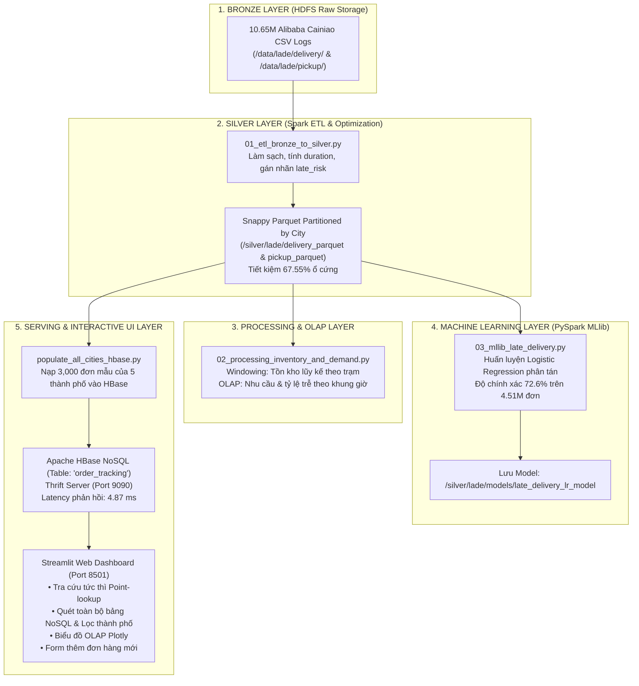

# 📦 ALIBABA CAINIAO BIG DATA LAKEHOUSE & DELIVERY RISK FORECASTING SYSTEM
> **Dự án Chuỗi Cung ứng & Dự báo Rủi ro Giao hàng trên nền tảng Big Data Lakehouse: Apache Hadoop HDFS + Apache Spark + PySpark MLlib + Apache HBase NoSQL + Streamlit Dashboard.**

---

## 📑 MỤC LỤC
1. [Tổng quan Dự án & Kết quả Thực nghiệm](#1-tổng-quan-dự-án--kết-quả-thực-nghiệm)
2. [Sơ đồ Kiến trúc Hệ thống](#2-sơ-đồ-kiến-trúc-hệ-thống)
3. [Cấu trúc Thư mục Source Code](#3-cấu-trúc-thư-mục-source-code)
4. [HƯỚNG DẪN CÀI ĐẶT TỪ ĐẦU ĐẾN CUỐI (STEP-BY-STEP)](#4-hướng-dẫn-cài-đặt-từ-đầu-đến-cuối-step-by-step)
   * [Bước 1: Cài đặt Java 17, SSH và Python](#bước-1-cài-đặt-java-17-ssh-và-python)
   * [Bước 2: Cài đặt Hadoop, Spark & HBase](#bước-2-cài-đặt-hadoop-spark--hbase)
   * [Bước 3: Cấu hình Biến môi trường (~/.bashrc)](#bước-3-cấu-hình-biến-môi-trường-bashrc)
   * [Bước 4: Cấu hình các file XML của Hadoop & HBase](#bước-4-cấu-hình-các-file-xml-của-hadoop--hbase)
   * [Bước 5: Định dạng NameNode & Khởi động toàn bộ Cụm](#bước-5-định-dạng-namenode--khởi-động-toàn-bộ-cụm)
5. [HƯỚNG DẪN CHẠY 5 GIAI ĐOẠN DỮ LIỆU](#5-hướng-dẫn-chạy-5-giai-đoạn-dữ-liệu)
   * [Giai đoạn 1: Tải dữ liệu thực tế Cainiao & Nạp vào Bronze HDFS](#giai-đoạn-1-tải-dữ-liệu-thực-tế-cainiao--nạp-vào-bronze-hdfs)
   * [Giai đoạn 2: PySpark ETL sang Silver Parquet (Nén & Phân vùng)](#giai-đoạn-2-pyspark-etl-sang-silver-parquet-nén--phân-vùng)
   * [Giai đoạn 3: Phân tích Tồn kho Lũy kế & OLAP Khung giờ](#giai-đoạn-3-phân-tích-tồn-kho-lũy-kế--olap-khung-giờ)
   * [Giai đoạn 4: Huấn luyện Machine Learning phân tán (Spark MLlib)](#giai-đoạn-4-huấn-luyện-machine-learning-phân-tán-spark-mllib)
   * [Giai đoạn 5: Serving NoSQL HBase & Khởi chạy Web Dashboard](#giai-đoạn-5-serving-nosql-hbase--khởi-chạy-web-dashboard)
6. [Xử lý Sự cố & Lỗi thường gặp (Troubleshooting)](#6-xử-lý-sự-cố--lỗi-thường-gặp-troubleshooting)

---

## 1. Tổng quan Dự án & Kết quả Thực nghiệm

Dự án triển khai mô hình kiến trúc **Big Data Lakehouse** chuẩn doanh nghiệp xử lý bài toán chuỗi cung ứng logistics:
* **Tập dữ liệu thực nghiệm:** **10,650,808 bản ghi** (~1.6 GB CSV gốc) từ tập đoàn thương mại điện tử **Alibaba Cainiao (Cainiao-AI/LaDe)** tại 5 đô thị: Thượng Hải (`sh`), Hàng Châu (`hz`), Trùng Khánh (`cq`), Yên Đài (`yt`), Cát Lâm (`jl`).
* **Tính xác thực:** Dữ liệu kép gồm luồng Gom hàng (Pickup - Inbound) và Giao hàng (Delivery - Outbound), tọa độ GPS shipper, timestamp thực tế. Tuyệt đối không sinh dữ liệu ảo (Zero synthetic inflation).

### 📊 Bảng số liệu thực nghiệm đo lường (Empirical Benchmarks):
| Tiêu chí | Trước tối ưu / Truyền thống | Sau tối ưu / Big Data Lakehouse | Kết quả thực tế đo được |
| :--- | :--- | :--- | :--- |
| **Dung lượng lưu trữ** | Raw CSV: **1,607 MB** | Snappy Parquet: **521 MB** | **Tiết kiệm 67.55% dung lượng** |
| **Tốc độ truy vấn OLAP** | Full Table Scan: **1.806 s** | Partition Pruning (`city`): **0.233 s** | **Tăng tốc 7.75 lần** |
| **Machine Learning** | Đơn máy dễ gặp lỗi tràn RAM (OOM) | PySpark MLlib Logistic Regression | **Huấn luyện 4.51M mẫu trong 17.18s**, Accuracy: **72.6%**, ROC-AUC: **0.6695** |
| **Độ trễ phục vụ (Serving)**| Quét OLAP Spark SQL: ~1.5 s | NoSQL HBase qua Thrift (Port 9090) | **Point-lookup latency: 4.87 ms (Siêu tốc)** |

---

## 2. Sơ đồ Kiến trúc Hệ thống



---

## 3. Cấu trúc Thư mục Source Code

```text
├── README.md                          # Tài liệu hướng dẫn chi tiết toàn bộ dự án
├── app.py                             # Giao diện Web tương tác Streamlit 4 Tab
├── requirements.txt                   # Danh sách thư viện Python phụ thuộc
├── hadoopsetupguide.docx              # Tài liệu thiết lập hạ tầng mẫu
├── benchmark/                         # Báo cáo kết quả thực nghiệm đo lường
│   ├── benchmark_storage.txt          # Kết quả so sánh dung lượng Bronze vs Silver
│   ├── benchmark_query_performance.txt# Kết quả đo tốc độ truy vấn Partition Pruning
│   ├── benchmark_mllib_report.txt     # Báo cáo đánh giá mô hình MLlib
│   └── benchmark_serving_latency.txt  # Đo lường độ trễ truy vấn HBase NoSQL
└── scripts/                           # Kịch bản thực thi chu trình dữ liệu
    ├── 01_etl_bronze_to_silver.py     # ETL Bronze CSV -> Silver Parquet phân vùng theo city
    ├── 02_processing_inventory_and_demand.py # Tính tồn kho theo trạm & phân tích khung giờ
    ├── 03_mllib_late_delivery.py      # Huấn luyện mô hình Logistic Regression dự báo trễ hạn
    ├── 04_serving_query_hbase.py      # Benchmark kiểm tra độ trễ truy vấn HBase
    └── populate_all_cities_hbase.py   # Nạp mẫu dữ liệu cả 5 thành phố vào HBase NoSQL
```

---

## 4. HƯỚNG DẪN CÀI ĐẶT TỪ ĐẦU ĐẾN CUỐI (STEP-BY-STEP)

> Áp dụng trên môi trường **Ubuntu 22.04 LTS** (Khuyên dùng WSL2 trên Windows hoặc máy ảo Linux).

### Bước 1: Cài đặt Java 17, SSH và Python
Mở terminal Ubuntu và chạy các lệnh:
```bash
sudo apt update && sudo apt upgrade -y
sudo apt install -y openjdk-17-jdk ssh pdsh wget curl git python3-pip

# Thiết lập SSH không mật khẩu (bắt buộc đối với Hadoop)
ssh-keygen -t rsa -P '' -f ~/.ssh/id_rsa
cat ~/.ssh/id_rsa.pub >> ~/.ssh/authorized_keys
chmod 0600 ~/.ssh/authorized_keys

# Bật service SSH và test kết nối
sudo service ssh start
ssh localhost -o StrictHostKeyChecking=no
exit
```

### Bước 2: Cài đặt Hadoop, Spark & HBase
Tải và giải nén các phần mềm vào thư mục `/usr/local`:
```bash
# 1. Cài đặt Hadoop 3.5.0
wget https://dlcdn.apache.org/hadoop/common/hadoop-3.5.0/hadoop-3.5.0.tar.gz
sudo tar -xvzf hadoop-3.5.0.tar.gz -C /usr/local/
sudo mv /usr/local/hadoop-3.5.0 /usr/local/hadoop
sudo chown -R $USER:$USER /usr/local/hadoop

# 2. Cài đặt Apache Spark 4.2.0 (Hadoop 3)
wget https://archive.apache.org/dist/spark/spark-4.2.0/spark-4.2.0-bin-hadoop3.tgz
sudo tar -xvzf spark-4.2.0-bin-hadoop3.tgz -C /usr/local/
sudo mv /usr/local/spark-4.2.0-bin-hadoop3 /usr/local/spark
sudo chown -R $USER:$USER /usr/local/spark

# 3. Cài đặt Apache HBase 2.6.7
wget https://dlcdn.apache.org/hbase/2.6.7/hbase-2.6.7-bin.tar.gz
sudo tar -xvzf hbase-2.6.7-bin.tar.gz -C /usr/local/
sudo mv /usr/local/hbase-2.6.7 /usr/local/hbase
sudo chown -R $USER:$USER /usr/local/hbase
```

### Bước 3: Cấu hình Biến môi trường (`~/.bashrc`)
Mở file cấu hình người dùng:
```bash
nano ~/.bashrc
```
Kéo xuống cuối file và dán toàn bộ đoạn sau:
```bash
# Java Home
export JAVA_HOME=/usr/lib/jvm/java-17-openjdk-amd64
export PATH=$PATH:$JAVA_HOME/bin

# Hadoop Variables
export HADOOP_HOME=/usr/local/hadoop
export HADOOP_INSTALL=$HADOOP_HOME
export HADOOP_MAPRED_HOME=$HADOOP_HOME
export HADOOP_COMMON_HOME=$HADOOP_HOME
export HADOOP_HDFS_HOME=$HADOOP_HOME
export YARN_HOME=$HADOOP_HOME
export HADOOP_COMMON_LIB_NATIVE_DIR=$HADOOP_HOME/lib/native
export HADOOP_OPTS="-Djava.library.path=$HADOOP_HOME/lib/native"
export HADOOP_CONF_DIR=$HADOOP_HOME/etc/hadoop
export PATH=$PATH:$HADOOP_HOME/bin:$HADOOP_HOME/sbin

# Spark Variables
export SPARK_HOME=/usr/local/spark
export PATH=$PATH:$SPARK_HOME/bin:$SPARK_HOME/sbin
export PYSPARK_PYTHON=python3

# HBase Variables
export HBASE_HOME=/usr/local/hbase
export PATH=$PATH:$HBASE_HOME/bin

# PySpark Module Path
export PYTHONPATH="/usr/local/spark/python:/usr/local/spark/python/lib/py4j-0.10.9.9-src.zip:$PYTHONPATH"
```
Lưu file (`Ctrl + O`, Enter, `Ctrl + X`) và kích hoạt biến môi trường:
```bash
source ~/.bashrc
```

Cấu hình liên kết PySpark và cài đặt các thư viện Python:
```bash
# Cài đặt các thư viện phụ thuộc
pip3 install streamlit happybase pandas plotly "numpy>=1.22" thriftpy2

# Tạo liên kết vĩnh viễn để python3 luôn nhận pyspark
sudo bash -c "echo '/usr/local/spark/python' > /usr/local/lib/python3.10/dist-packages/spark.pth"
sudo bash -c "echo '/usr/local/spark/python/lib/py4j-0.10.9.9-src.zip' >> /usr/local/lib/python3.10/dist-packages/spark.pth"
```

### Bước 4: Cấu hình các file XML của Hadoop & HBase

#### 1. Cấu hình `hadoop-env.sh`:
Mở `/usr/local/hadoop/etc/hadoop/hadoop-env.sh` và thêm vào cuối:
```bash
export JAVA_HOME=/usr/lib/jvm/java-17-openjdk-amd64
```

#### 2. Cấu hình `/usr/local/hadoop/etc/hadoop/core-site.xml`:
```xml
<configuration>
    <property>
        <name>fs.defaultFS</name>
        <value>hdfs://localhost:9000</value>
    </property>
</configuration>
```

#### 3. Cấu hình `/usr/local/hadoop/etc/hadoop/hdfs-site.xml`:
```xml
<configuration>
    <property>
        <name>dfs.replication</name>
        <value>1</value>
    </property>
    <property>
        <name>dfs.namenode.name.dir</name>
        <value>file:///usr/local/hadoop/data/namenode</value>
    </property>
    <property>
        <name>dfs.datanode.data.dir</name>
        <value>file:///usr/local/hadoop/data/datanode</value>
    </property>
</configuration>
```

#### 4. Cấu hình `/usr/local/hadoop/etc/hadoop/yarn-site.xml`:
```xml
<configuration>
    <property>
        <name>yarn.nodemanager.aux-services</name>
        <value>mapreduce_shuffle</value>
    </property>
    <property>
        <name>yarn.nodemanager.env-whitelist</name>
        <value>JAVA_HOME,HADOOP_COMMON_HOME,HADOOP_HDFS_HOME,HADOOP_CONF_DIR,CLASSPATH_PRETEND_DISTCACHE,HADOOP_YARN_HOME,HADOOP_HOME,PATH,LANG,TZ,HADOOP_MAPRED_HOME</value>
    </property>
</configuration>
```

#### 5. Cấu hình `/usr/local/hbase/conf/hbase-env.sh`:
Thêm vào cuối file:
```bash
export JAVA_HOME=/usr/lib/jvm/java-17-openjdk-amd64
export HBASE_MANAGES_ZK=true
```

#### 6. Cấu hình `/usr/local/hbase/conf/hbase-site.xml`:
```xml
<configuration>
    <property>
        <name>hbase.cluster.distributed</name>
        <value>true</value>
    </property>
    <property>
        <name>hbase.rootdir</name>
        <value>hdfs://localhost:9000/hbase</value>
    </property>
    <property>
        <name>hbase.zookeeper.property.dataDir</name>
        <value>/usr/local/hbase/zookeeper</value>
    </property>
    <property>
        <name>hbase.zookeeper.property.clientPort</name>
        <value>2181</value>
    </property>
    <property>
        <name>hbase.unsafe.stream.capability.enforce</name>
        <value>false</value>
    </property>
</configuration>
```

### Bước 5: Định dạng NameNode & Khởi động toàn bộ Cụm

```bash
# Định dạng hệ thống tệp NameNode (chỉ làm LẦN ĐẦU TIÊN)
hdfs namenode -format

# Khởi động HDFS & YARN
start-dfs.sh
start-yarn.sh

# Khởi động HBase & Cổng kết nối Thrift (Port 9090)
start-hbase.sh
hbase thrift start &
```

Kiểm tra bằng lệnh:
```bash
jps
```
Kết quả cần có đủ các tiến trình:
* `NameNode`
* `DataNode`
* `SecondaryNameNode`
* `ResourceManager`
* `NodeManager`
* `HMaster`
* `HRegionServer`
* `HQuorumPeer`
* `ThriftServer`

---

## 5. HƯỚNG DẪN CHẠY 5 GIAI ĐOẠN DỮ LIỆU

Clone dự án về máy:
```bash
git clone <URL_REPO_CUA_BAN> ~/bigdata_project
cd ~/bigdata_project
```

### Giai đoạn 1: Tải dữ liệu thực tế Cainiao & Nạp vào Bronze HDFS
Tải toàn bộ 10 file CSV thực tế của 5 thành phố từ Hugging Face:
```bash
mkdir -p ~/datasets/lade/delivery ~/datasets/lade/pickup
cd ~/datasets/lade

# Tải luồng Giao hàng (Delivery)
wget -O delivery/delivery_sh.csv https://huggingface.co/datasets/Cainiao-AI/LaDe/resolve/main/delivery/delivery_sh.csv
wget -O delivery/delivery_hz.csv https://huggingface.co/datasets/Cainiao-AI/LaDe/resolve/main/delivery/delivery_hz.csv
wget -O delivery/delivery_cq.csv https://huggingface.co/datasets/Cainiao-AI/LaDe/resolve/main/delivery/delivery_cq.csv
wget -O delivery/delivery_yt.csv https://huggingface.co/datasets/Cainiao-AI/LaDe/resolve/main/delivery/delivery_yt.csv
wget -O delivery/delivery_jl.csv https://huggingface.co/datasets/Cainiao-AI/LaDe/resolve/main/delivery/delivery_jl.csv

# Tải luồng Gom hàng (Pickup)
wget -O pickup/pickup_sh.csv https://huggingface.co/datasets/Cainiao-AI/LaDe/resolve/main/pickup/pickup_sh.csv
wget -O pickup/pickup_hz.csv https://huggingface.co/datasets/Cainiao-AI/LaDe/resolve/main/pickup/pickup_hz.csv
wget -O pickup/pickup_cq.csv https://huggingface.co/datasets/Cainiao-AI/LaDe/resolve/main/pickup/pickup_cq.csv
wget -O pickup/pickup_yt.csv https://huggingface.co/datasets/Cainiao-AI/LaDe/resolve/main/pickup/pickup_yt.csv
wget -O pickup/pickup_jl.csv https://huggingface.co/datasets/Cainiao-AI/LaDe/resolve/main/pickup/pickup_jl.csv

# Nạp dữ liệu vào Bronze Layer trên HDFS
hdfs dfs -mkdir -p /data/lade/delivery /data/lade/pickup
hdfs dfs -put delivery/*.csv /data/lade/delivery/
hdfs dfs -put pickup/*.csv /data/lade/pickup/

# Kiểm tra dung lượng trên HDFS (~1.6 GB)
hdfs dfs -du -h /data/lade/
```

### Giai đoạn 2: PySpark ETL sang Silver Parquet (Nén & Phân vùng)
Chuyển đổi CSV thô sang Snappy Parquet phân vùng theo `city`:
```bash
cd ~/bigdata_project
spark-submit --master "local[4]" --driver-memory 4g scripts/01_etl_bronze_to_silver.py
```
* **Kết quả:** Parquet được lưu tại `/silver/lade/delivery_parquet` và `/silver/lade/pickup_parquet`.
* Xem báo cáo tỷ lệ nén (tiết kiệm 67.55% ổ cứng):
```bash
cat benchmark/benchmark_storage.txt
```

### Giai đoạn 3: Phân tích Tồn kho Lũy kế & OLAP Khung giờ
Thực thi xử lý phân tích nâng cao (Windowing & OLAP):
```bash
spark-submit --master "local[4]" --driver-memory 4g scripts/02_processing_inventory_and_demand.py
```
* **Kết quả:** Tạo bảng tồn kho trạm `/silver/lade/inventory_summary_parquet` và nhu cầu theo giờ `/silver/lade/hourly_demand_parquet`.
* Xem báo cáo tăng tốc 7.75 lần nhờ Partition Pruning:
```bash
cat benchmark/benchmark_query_performance.txt
```

### Giai đoạn 4: Huấn luyện Machine Learning phân tán (Spark MLlib)
Xây dựng ML Pipeline tiền xử lý và huấn luyện phân tán mô hình dự báo trễ hạn trên 4.51 triệu đơn:
```bash
spark-submit --master "local[4]" --driver-memory 4g scripts/03_mllib_late_delivery.py
```
* **Kết quả:** Mô hình được lưu tại `hdfs://localhost:9000/silver/lade/models/late_delivery_lr_model`.
* Xem báo cáo độ chính xác (Accuracy: 72.6%):
```bash
cat benchmark/benchmark_mllib_report.txt
```

### Giai đoạn 5: Serving NoSQL HBase & Khởi chạy Web Dashboard
Nạp mẫu 3.000 đơn hàng của cả 5 thành phố vào bảng `order_tracking` của HBase:
```bash
# 1. Nạp dữ liệu vào NoSQL
python3 scripts/populate_all_cities_hbase.py

# 2. Đo kiểm độ trễ truy vấn HBase NoSQL (< 5ms)
python3 scripts/04_serving_query_hbase.py

# 3. Khởi chạy Giao diện Web tương tác Streamlit
python3 -m streamlit run app.py --server.port 8501 --server.address 0.0.0.0
```

Truy cập trình duyệt tại Windows:
👉 **`http://localhost:8501`** (hoặc `http://<IP_WSL>:8501`)

---

## 6. Xử lý Sự cố & Lỗi thường gặp (Troubleshooting)

| Lỗi gặp phải | Nguyên nhân | Cách khắc phục triệt để |
| :--- | :--- | :--- |
| `TypeError: 'type' object is not subscriptable` tại `DenseVector` | NumPy cũ (`<1.22`) xung đột với type-hint generic của Spark 4.2.0 | Chạy lệnh: `pip3 install --upgrade "numpy>=1.22"` |
| `ModuleNotFoundError: No module named 'pyspark'` khi chạy python trực tiếp | Python không tự load thư viện nằm ngoài `site-packages` | Chạy lệnh: `sudo bash -c "echo '/usr/local/spark/python' > /usr/local/lib/python3.10/dist-packages/spark.pth"` |
| `Connection refused` tới HDFS cổng 9000 hoặc Thrift cổng 9090 | Dịch vụ Hadoop hoặc HBase bị tắt sau khi khởi động lại máy/WSL | Chạy lần lượt: `sudo service ssh start && start-dfs.sh && start-yarn.sh && start-hbase.sh && hbase thrift start &` |
| Bị lỗi `Permission denied (publickey)` khi chạy `start-dfs.sh` | Chưa cấp quyền khóa SSH hoặc service sshd chưa bật | Chạy: `cat ~/.ssh/id_rsa.pub >> ~/.ssh/authorized_keys && chmod 0600 ~/.ssh/authorized_keys && sudo service ssh start` |
| `WARNING: YARN_CONF_DIR has been replaced by HADOOP_CONF_DIR` | Xung đột biến môi trường cũ trong `~/.bashrc` | Bỏ dòng `export YARN_CONF_DIR` trong `~/.bashrc`, chỉ giữ `export HADOOP_CONF_DIR` |
