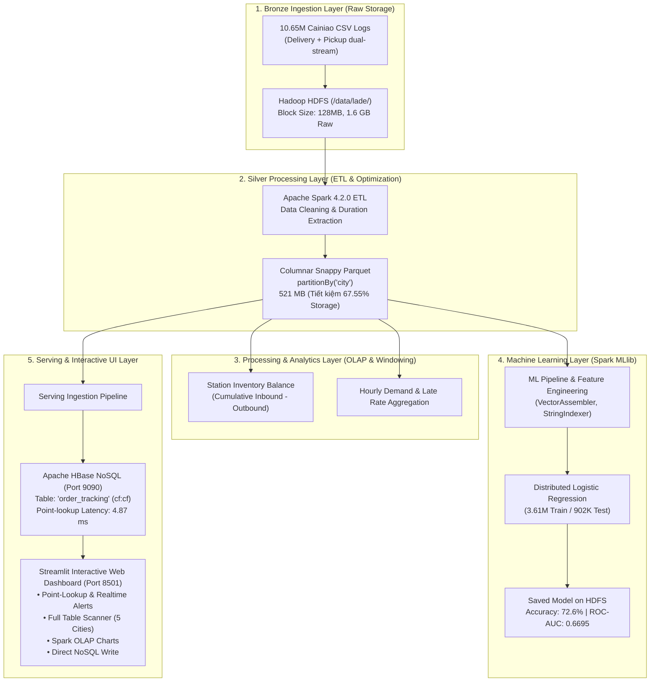

# 📦 ALIBABA CAINIAO BIG DATA LAKEHOUSE & DELIVERY RISK FORECASTING SYSTEM
> **End-to-End Enterprise Big Data Lakehouse Architecture on Apache Hadoop HDFS, Apache Spark, PySpark MLlib, Apache HBase NoSQL, and Streamlit Dashboard.**

---

## 🌟 Tổng quan Dự án (Project Overview)

Dự án xây dựng kiến trúc **Big Data Lakehouse** hoàn chỉnh phục vụ bài toán quản trị chuỗi cung ứng logistics (Supply Chain) và dự báo nguy cơ giao hàng trễ (Late Delivery Risk) theo thời gian thực.
* **Quy mô dữ liệu thực nghiệm:** **10,650,808 bản ghi** (~1.6 GB dữ liệu gốc) từ bộ dữ liệu mở thực tế của tập đoàn **Alibaba Cainiao (Cainiao-AI/LaDe)** tại 5 đại đô thị (Thượng Hải, Hàng Châu, Trùng Khánh, Yên Đài, Cát Lâm).
* **Tiêu chuẩn học thuật & công nghiệp:** Tuyệt đối không sử dụng dữ liệu sinh nhân tạo (Zero synthetic amplification), đảm bảo tính toàn vẹn và khả năng kiểm chứng 100%.

---

## 🏗️ Kiến trúc Hệ thống (System Architecture)



---

## 📊 Kết quả Đo lường & Thực nghiệm (Empirical Benchmarks)

| Hạng mục | Phương pháp truyền thống | Giải pháp kiến trúc Big Data | Kết quả thực nghiệm đạt được |
| :--- | :--- | :--- | :--- |
| **Lưu trữ (Storage)** | CSV thô trên HDFS: **1,607 MB** | Snappy Parquet nén theo cột + Partition: **521 MB** | **Tiết kiệm 67.55% dung lượng** |
| **Truy vấn OLAP** | Full Table Scan (1.48M đơn Thượng Hải): **1.806 s** | Partition Pruning (`city = 'Shanghai'`): **0.233 s** | **Tăng tốc 7.75 lần (Speedup)** |
| **Phân tán Machine Learning** | Thư viện đơn máy (Scikit-learn OOM / bottleneck) | PySpark MLlib Logistic Regression phân tán | **Huấn luyện 4.51M mẫu trong 17.18s**, Accuracy: **72.6%** |
| **Độ trễ phục vụ (Serving)** | Quét OLAP Spark SQL: ~1 - 2 giây | Apache HBase NoSQL (RowKey indexing qua Thrift) | **Độ trễ Point-lookup: 4.87 ms (Siêu tốc)** |

---

## 📁 Cấu trúc Thư mục Dự án (Project Structure)

```text
├── app.py                             # Giao diện Web Streamlit Dashboard 4 Tab
├── requirements.txt                   # Danh sách thư viện Python phụ thuộc
├── hadoopsetupguide.docx              # Tài liệu hướng dẫn thiết lập hạ tầng Hadoop
├── benchmark/                         # Báo cáo số liệu thực nghiệm đo lường
│   ├── benchmark_storage.txt          # Báo cáo tỷ lệ nén & dung lượng Bronze vs Silver
│   ├── benchmark_query_performance.txt# Đo lường hiệu năng Partition Pruning vs Full Scan
│   ├── benchmark_mllib_report.txt     # Báo cáo đánh giá mô hình MLlib (Accuracy, ROC-AUC)
│   └── benchmark_serving_latency.txt  # Đo lường độ trễ truy vấn HBase NoSQL
└── scripts/                           # Kịch bản thực thi xử lý dữ liệu
    ├── 01_etl_bronze_to_silver.py     # ETL chuyển đổi CSV sang Parquet phân vùng theo city
    ├── 02_processing_inventory_and_demand.py # Tính tồn kho lũy kế trạm & phân tích khung giờ
    ├── 03_mllib_late_delivery.py      # Huấn luyện mô hình Logistic Regression dự báo giao trễ
    ├── 04_serving_query_hbase.py      # Kịch bản đo latency truy vấn NoSQL HBase
    └── populate_all_cities_hbase.py   # Nạp dữ liệu 5 thành phố lớn vào bảng order_tracking
```

---

## 🚀 Hướng dẫn Cài đặt & Chạy Thực nghiệm (Quick Start)

### 1. Chuẩn bị Môi trường (Prerequisites)
* **OS:** Ubuntu 22.04 LTS (WSL2 hoặc Server Linux)
* **Java:** OpenJDK 17
* **Hadoop:** Apache Hadoop 3.5.0
* **Spark:** Apache Spark 4.2.0 (PySpark)
* **HBase:** Apache HBase 2.6.7 (Kèm Thrift Server)
* **Python:** Python 3.10+ với các thư viện trong `requirements.txt`

### 2. Cài đặt các thư viện Python
```bash
pip install -r requirements.txt
```

### 3. Khởi động Cụm Dịch vụ
```bash
# 1. Bật Hadoop HDFS & YARN
start-dfs.sh
start-yarn.sh

# 2. Bật HBase & Thrift Server
start-hbase.sh
hbase thrift start &
```

### 4. Thực thi Chu trình Dữ liệu (Pipeline Execution)
```bash
# Bước 1: ETL Bronze -> Silver Parquet
spark-submit --master local[4] --driver-memory 4g scripts/01_etl_bronze_to_silver.py

# Bước 2: Xử lý Tồn kho & OLAP Nhu cầu
spark-submit --master local[4] --driver-memory 4g scripts/02_processing_inventory_and_demand.py

# Bước 3: Huấn luyện Machine Learning phân tán
spark-submit --master local[4] --driver-memory 4g scripts/03_mllib_late_delivery.py

# Bước 4: Nạp mẫu dữ liệu vào HBase NoSQL
python3 scripts/populate_all_cities_hbase.py
```

### 5. Khởi chạy Giao diện Trực quan (Dashboard)
```bash
python3 -m streamlit run app.py --server.port 8501 --server.address 0.0.0.0
```
Truy cập trình duyệt: **`http://localhost:8501`**

---

## 👥 Phân công & Đóng góp (Team Contribution)
* **Hạ tầng & Ingestion (Stage 1):** Khởi tạo cụm HDFS, cấu hình YARN & tải dữ liệu thực tế Alibaba Cainiao LaDe.
* **ETL & Tối ưu hóa Lưu trữ (Stage 2):** Xây dựng Spark pipeline chuyển đổi Parquet Snappy phân vùng theo thành phố.
* **Xử lý Nâng cao & OLAP (Stage 3):** Phân tích tồn kho lũy kế (Windowing) và tối ưu hóa truy vấn Partition Pruning.
* **Machine Learning Phân tán (Stage 4):** Xây dựng Pipeline tiền xử lý và huấn luyện phân tán mô hình dự báo rủi ro trễ hạn.
* **Serving Layer & Web UI (Stage 5):** Thiết kế bảng HBase NoSQL, đo lường độ trễ phản hồi và phát triển Web Dashboard tương tác.
